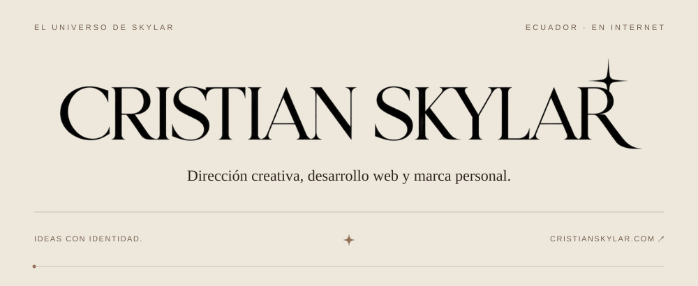
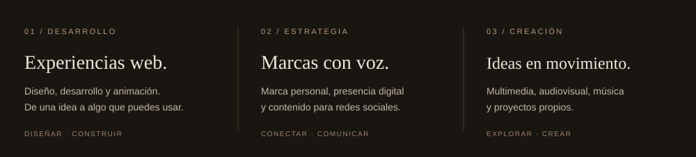

 

### Hola, soy Cristian.

Me gusta darle forma a las ideas: a veces terminan en una web, otras en una marca, una canción o un proyecto audiovisual. Trabajo entre el diseño, la tecnología y la comunicación, buscando que lo que creo tenga identidad propia.

Este espacio reúne mi lado de desarrollo web y las cosas que voy construyendo en el camino.

 

 

### Lo que encontrarás por aquí

**Webs y experiencias digitales**  
Sitios a medida, interfaces y pequeñas ideas que convierto en proyectos.

**Exploraciones creativas**  
Pruebas de diseño y animación para seguir encontrando mi estilo.

**Proyectos con mi nombre**  
Un lugar para compartir lo que nazca de mi curiosidad y mis ganas de crear.

 

### Herramientas web

`HTML` &nbsp; `CSS` &nbsp; `JavaScript` &nbsp; `GSAP`

 

### Sigamos conectados

[Mi sitio web ↗](https://cristianskylar.com) &nbsp; · &nbsp; [YouTube](https://www.youtube.com/@CristianSkylar) &nbsp; · &nbsp; [Instagram](https://www.instagram.com/CristianSkylarr/) &nbsp; · &nbsp; [X](https://x.com/CristianSkylarr)

 

---

CRISTIAN SKYLAR &nbsp; / &nbsp; ECUADOR &nbsp; / &nbsp; IDEAS CON IDENTIDAD.
