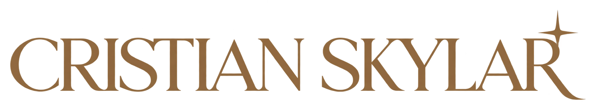
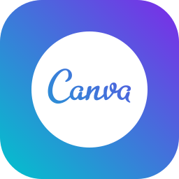
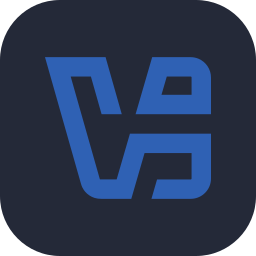

  

  <picture>
    <source media="(max-width: 600px)" srcset="assets/roles-mobile.svg">
    
  </picture>

### 👋 Sobre mí

Soy **Cristian Skylar**, de Ecuador. Trabajo en **dirección creativa, diseño web y mentoría de marca personal**.

- 💻 Diseño y desarrollo sitios web a medida.
- ✨ Trabajo con interfaces, diseño y animaciones web.
- 💬 Ayudo a profesionales a trabajar su marca personal y presencia digital.
- 🎨 Uso Canva y edito videos con CapCut a nivel básico.

---

### 🧰 Toolbox

**Web y desarrollo**

  &nbsp;
  &nbsp;
  &nbsp;
  &nbsp;
  &nbsp;
  &nbsp;
  &nbsp;

HTML5 · CSS3 · JavaScript · Tailwind CSS · React · WordPress · GSAP

 

**Diseño y software**

  &nbsp;
  &nbsp;
  &nbsp;
  &nbsp;
  &nbsp;

Canva · CapCut *(básico)* · Visual Studio Code · AnyDesk · VirtualBox

---

### 🤝 Conectemos

  &nbsp;
  &nbsp;
  &nbsp;
  &nbsp;
  &nbsp;

[LinkedIn](https://www.linkedin.com/in/cristianskylar/) · [Instagram](https://www.instagram.com/CristianSkylarr/) · [YouTube](https://www.youtube.com/@CristianSkylar) · [X](https://x.com/CristianSkylarr) · [Mi sitio web](https://cristianskylar.com)
